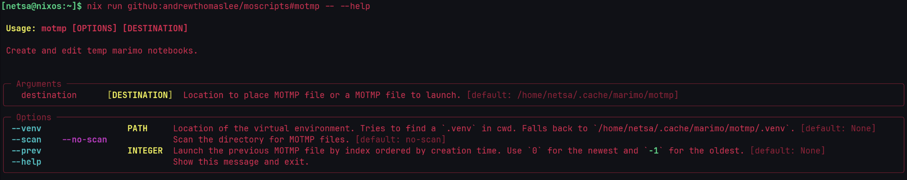
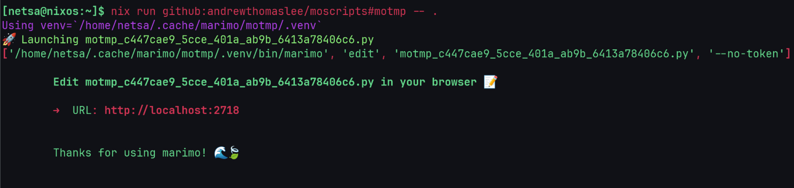

# motmp

Create and edit temporary [marimo](https://marimo.io) notebooks with a managed
virtual environment, for quick tests and prototypes.

- Notebooks live in `~/.cache/marimo/motmp` by default.
- On first run it creates a venv there with `uv` (`marimo[recommended]`,
  `python-lsp-server`, `websockets`, `watchdog`).
- Pass `.` as the destination to create the notebook in place; motmp then
  offers the `.venv` of the current directory.
- `--prev` reopens an earlier notebook, `--scan` lists them and offers to wipe
  them (both through `gum`).

```sh
nix run github:andrewthomaslee/moscripts#motmp -- --help
```



