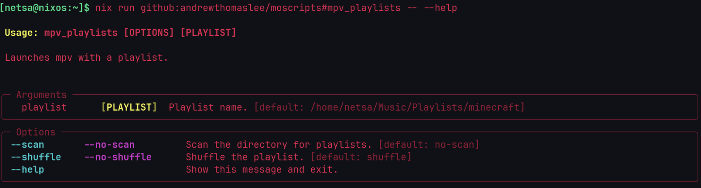
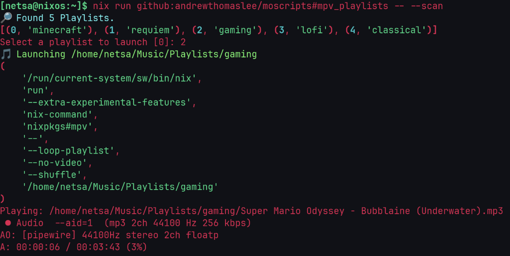

# mpv_playlists

Plays a playlist from `~/Music/Playlists` with mpv (audio only, looped,
shuffled by default).

```sh
mpv_playlists                    # the first playlist
mpv_playlists road-trip.m3u      # by name
mpv_playlists --scan             # pick one with gum
mpv_playlists --no-shuffle --directory ~/elsewhere
```

A missing or empty playlist directory is an error with a clear message; `--help`
works without one.



