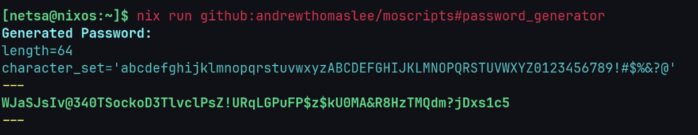
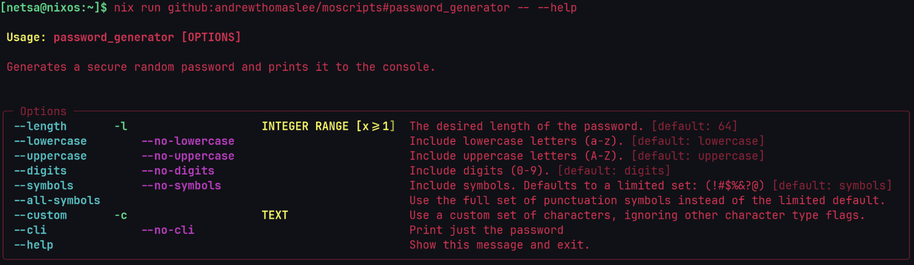

# password_generator

A cryptographically secure password generator (Python `secrets`).

```sh
password_generator                       # 64 chars: letters, digits, !#$%&?@
password_generator -l 24 --cli           # just the password
password_generator --all-symbols         # every punctuation character
password_generator --no-symbols -l 16
password_generator -c 0123456789 -l 6    # custom character set
```



